# GitOps and Argo CD Practical Lab Documentation

## 1. Executive Summary & Architecture Overview

This technical report documents the design, setup, and practical execution of a pull-based GitOps deployment pipeline using **Argo CD** running inside a multi-node **Kind** (Kubernetes in Docker) cluster.

Unlike traditional push-based CI/CD systems—where external automation tools hold cluster-admin credentials and push changes—this lab demonstrates a pull-based architecture where an in-cluster controller continuously monitors a Git repository as the **Single Source of Truth** and reconciles the live cluster state to match.

```
[ Developer ] ──(git push)──> [ GitHub Repository (Single Source of Truth) ]
                                          ▲
                                          │ (Continuous Pull / Reconcile)
                                          │
┌─────────────────────────────────────────┴─────────────────────────────────────────┐
│ Kind Kubernetes Cluster (dso202)                                                  │
│                                                                                   │
│  ┌─────────────────────────────────────────────────────────────────────────────┐  │
│  │ argocd Namespace                                                            │  │
│  │   • argocd-server (API & Web Dashboard - https://localhost:8888)            │  │
│  │   • argocd-repo-server (Fetches & Renders Git YAMLs)                        │  │
│  │   • argocd-application-controller (Reconciliation Engine)                   │  │
│  └───────────────────────────────────┬─────────────────────────────────────────┘  │
│                                      │ (Automated Sync / Self-Healing)            │
│                                      ▼                                            │
│  ┌─────────────────────────────────────────────────────────────────────────────┐  │
│  │ demo-app Namespace (Target Workloads)                                       │  │
│  │   • webapp-svc (Service - ClusterIP)                                        │  │
│  │   • webapp-deploy (Deployment - Replicas: 2 ──> 4)                          │  │
│  └─────────────────────────────────────────────────────────────────────────────┘  │
└───────────────────────────────────────────────────────────────────────────────────┘

```

---

## 2. Theoretical Foundations

### 2.1 The 4 Core Principles of GitOps

According to the OpenGitOps standard, this lab implements the four foundational rules:

1. **Declarative**: Cluster state (Deployments, Services) is written strictly in declarative YAML files.
2. **Versioned and Immutable**: All configuration changes are tracked via Git commit hashes, establishing an absolute audit trail.
3. **Pulled Automatically**: Argo CD runs as an agent inside the cluster, pulling updates directly from GitHub.
4. **Continuously Reconciled**: Argo CD constantly compares the **Desired State** (in GitHub) against the **Live State** (in Kubernetes) and corrects discrepancies automatically.

### 2.2 Custom Resource Definitions (CRDs) & Reconciliation

Argo CD extends the native Kubernetes API using Custom Resource Definitions (CRDs), introducing the `kind: Application` resource. The `argocd-application-controller` functions similarly to built-in Kubernetes controllers, maintaining an active loop:


$$\text{Desired State (GitHub)} \iff \text{Live State (Cluster)}$$

---

## 3. Comprehensive Implementation & Diagnostic Evidence Log

### Part 1: Environment Setup & Argo CD Deployment

#### 1. Helm Repository Addition & Chart Updating

The Argo CD Helm repository was registered and updated on the local management environment.

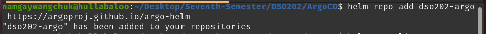

*Figure 3.1: Adding `dso202-argo` repository (`https://argoproj.github.io/argo-helm`).*

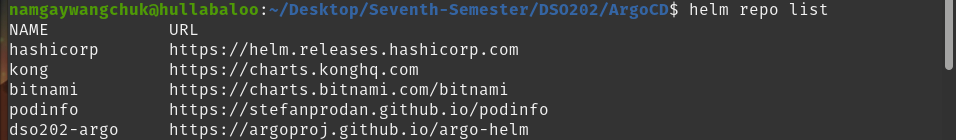

*Figure 3.2: Confirming `dso202-argo` in the active repository list.*

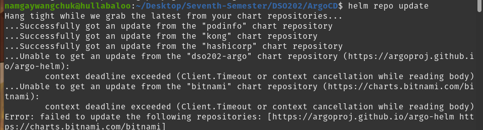

*Figure 3.3: Executing `helm repo update` to fetch the latest index.*

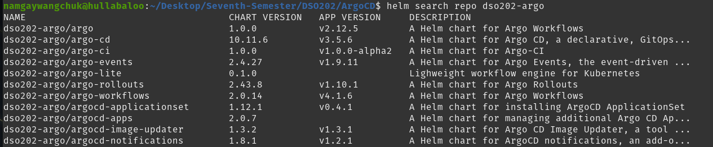

*Figure 3.4: Verifying availability of `dso202-argo/argo-cd` chart version `10.11.6`.*

#### 2. Installing Argo CD via Helm

Argo CD was deployed into its dedicated `argocd` namespace.

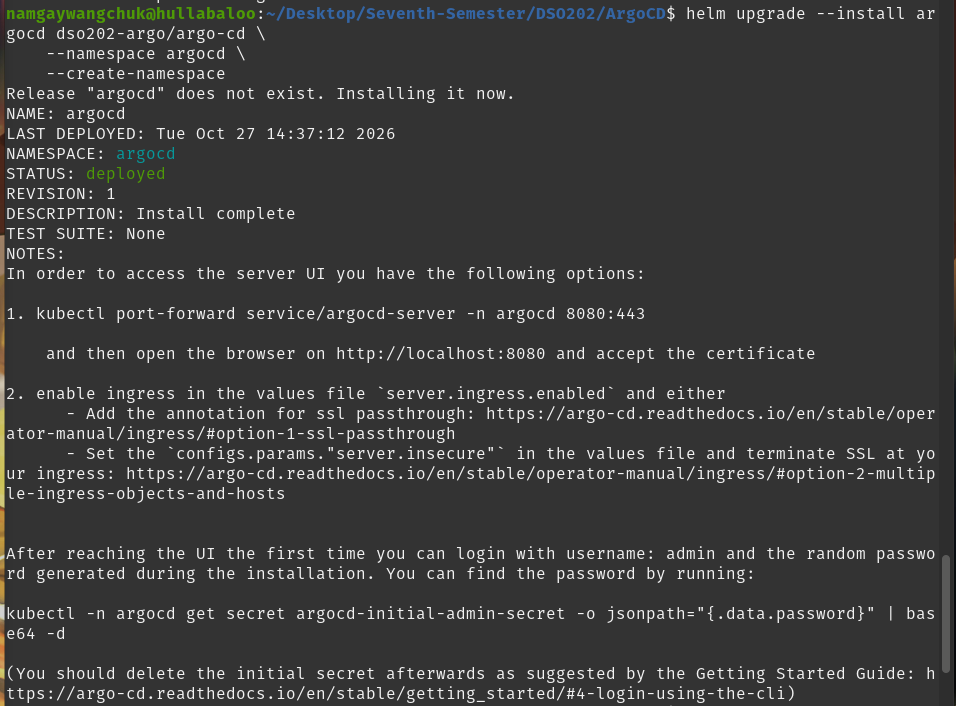

*Figure 3.5: Deploying Argo CD release `argocd` with namespace creation flags.*

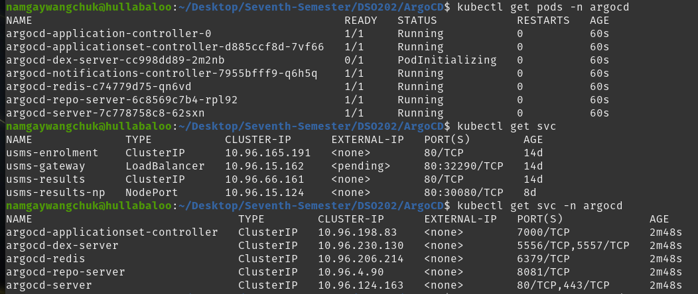

*Figure 3.6: Checking running status for `argocd-server`, `argocd-repo-server`, and `argocd-application-controller`.*

#### 3. Ingress, Authentication, and Dashboard Access

Local port forwarding was established and initial credentials decoded.

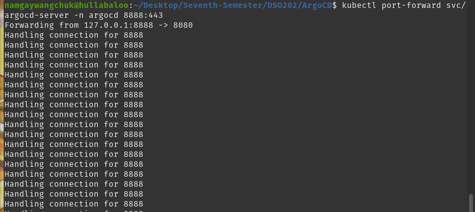

*Figure 3.7: Forwarding local port `8888` to `svc/argocd-server` port `443`.*

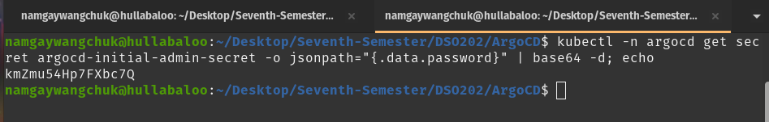

*Figure 3.8: Retrieving and decoding secret `argocd-initial-admin-secret`.*

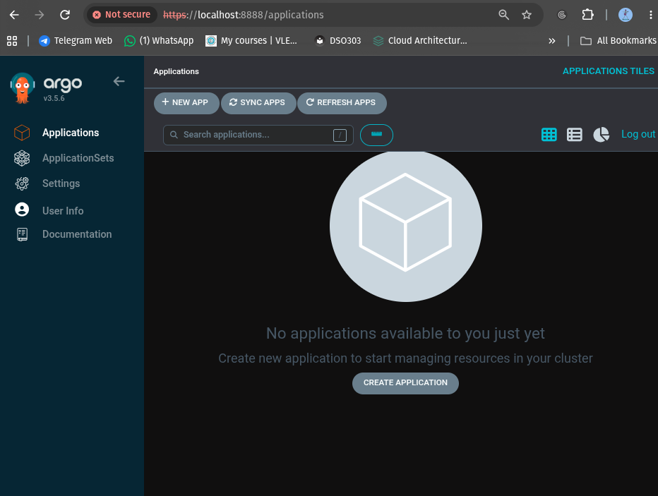

*Figure 3.9: Initial login to the Argo CD Web UI (`https://localhost:8888`) prior to application registration.*

---

### Part 2: GitHub Repository Setup & Declarative Registration

#### 1. Initializing the Configuration Repository

The Single Source of Truth repository (`dso202-gitops-demo`) was initialized with manifest definitions.

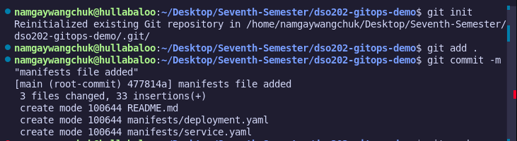

*Figure 3.10: Staging and committing `README.md`, `manifests/deployment.yaml`, and `manifests/service.yaml`.*

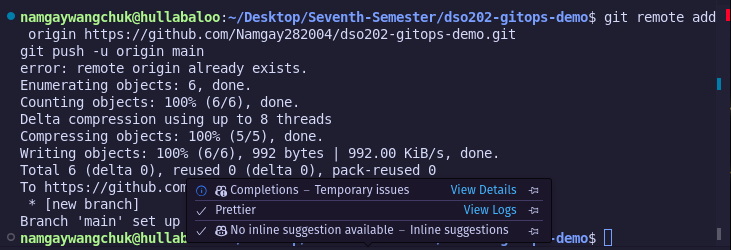

*Figure 3.11: Pushing initial manifests to remote `https://github.com/Namgay282004/dso202-gitops-demo.git`.*

#### 2. Declarative Application Registration (`argocd-app.yaml`)

An Argo CD `Application` Custom Resource was configured with `prune: true` and `selfHeal: true`.

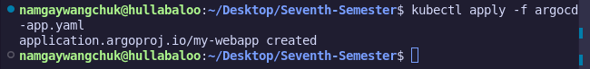

*Figure 3.12: Executing `kubectl apply -f argocd-app.yaml` to register `my-webapp`.*

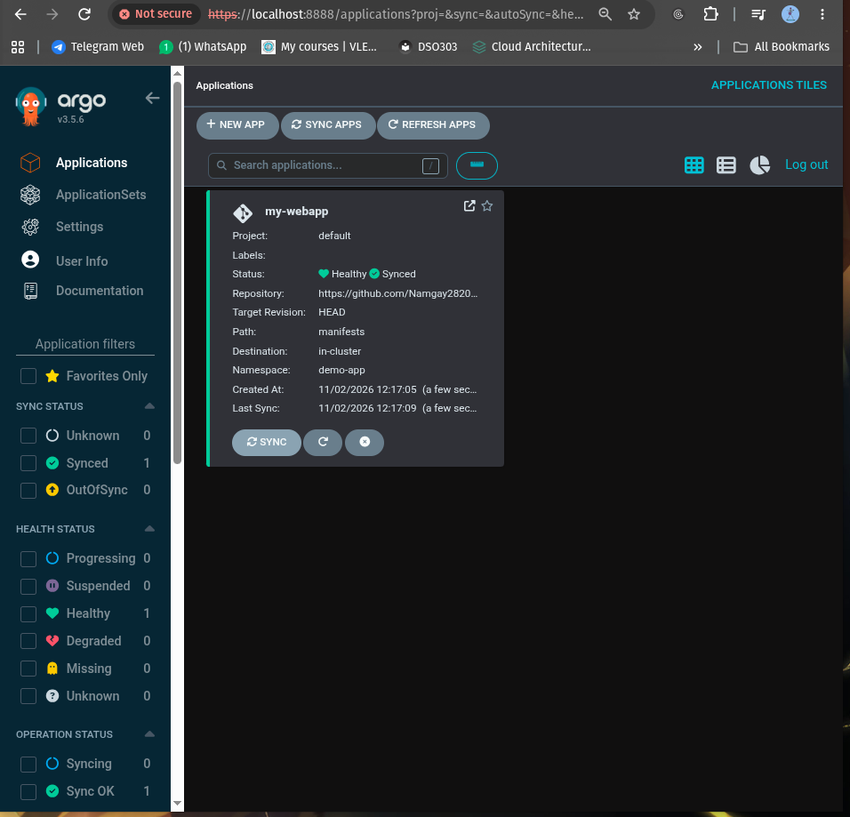

*Figure 3.13: Argo CD Web UI showing `my-webapp` tile in a `Healthy` and `Synced` state.*

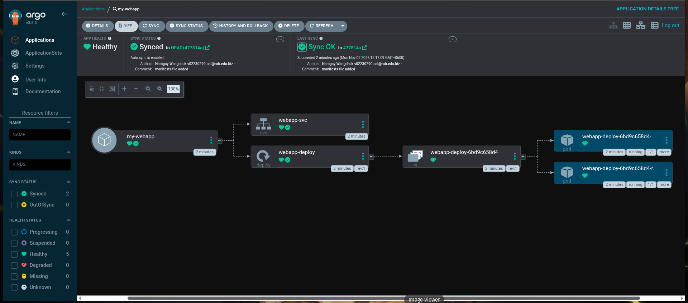

*Figure 3.14: Visual resource graph rendering `webapp-svc`, `webapp-deploy`, ReplicaSet, and 2 active Pods.*

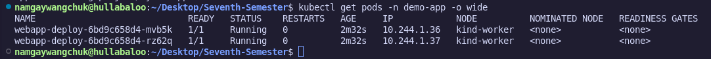

*Figure 3.15: `kubectl get pods -n demo-app -o wide` confirming 2 running pods distributed across Kind worker nodes.*

---

### Part 3: GitOps Experiments & Automated Lifecycle Management

#### Experiment 1: Automated Scaling via Git

Application scale was updated from 2 to 4 replicas purely through a Git commit.

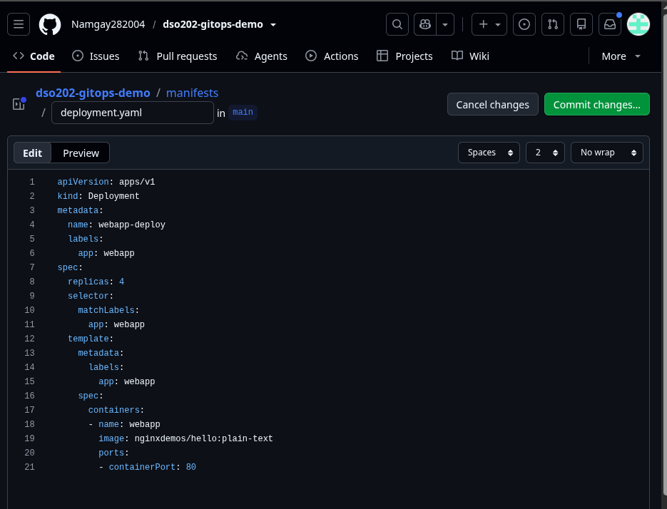

*Figure 3.16: Modifying `replicas: 2` to `replicas: 4` inside `manifests/deployment.yaml` on GitHub.*

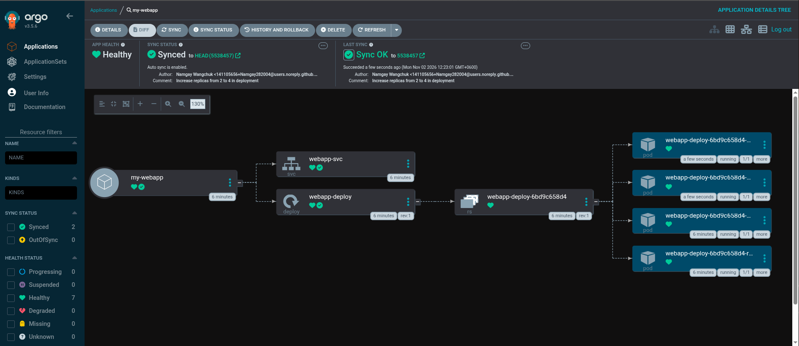

*Figure 3.17: Argo CD auto-syncing commit `5538457` and dynamically provisioning 4 running pods.*

#### Experiment 2: Configuration Drift & Self-Healing

A manual cluster modification was executed to test automated drift correction.

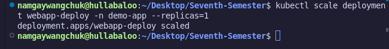

*Figure 3.18: Executing rogue command `kubectl scale deployment webapp-deploy -n demo-app --replicas=1`.*

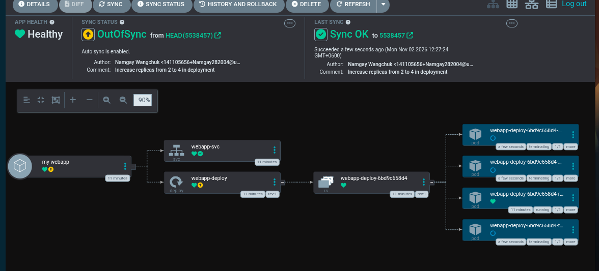

*Figure 3.19: Argo CD detecting manual drift (`OutOfSync`) as 3 pods enter termination state.*

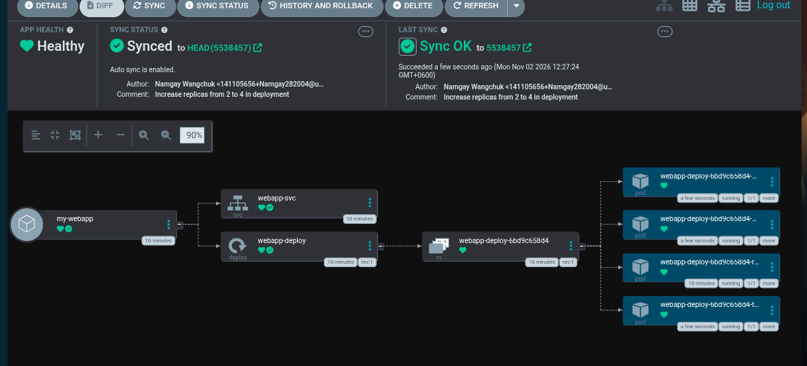

*Figure 3.20: Self-healing engine overriding manual changes and returning `Sync Status` to `Synced`.*

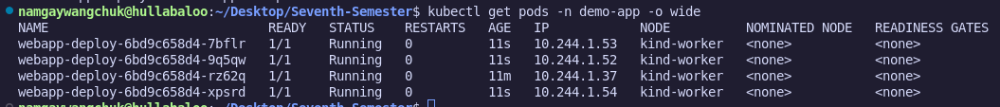

*Figure 3.21: Terminal check confirming all 4 pods recreated (`AGE: 11s`) in accordance with GitHub.*

#### Experiment 3: Automatic Resource Pruning

Resource deletion in GitHub was tested against the cluster garbage collector.

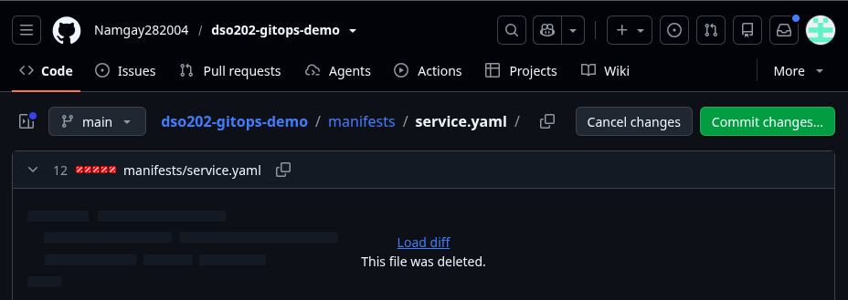

*Figure 3.22: Deleting `manifests/service.yaml` directly from the Git repository.*

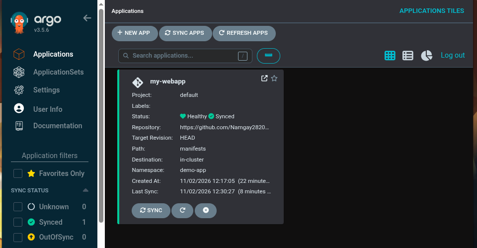

*Figure 3.23: Argo CD auto-pruning `webapp-svc` and bringing the remaining resources into a `Synced` state.*

---

## 4. Technical Diagnostics & Resolution Matrix

| # | Phase | Symptom / Issue | Root Cause | Resolution Strategy | Evidence |
| --- | --- | --- | --- | --- | --- |
| **1** | Setup | `helm repo update` connection timeout | Temporary network glitch or outdated chart cache. | Executed `helm repo update` to refresh index endpoints successfully. | *Figure 3.3* |
| **2** | Ingress | Unable to open Argo CD UI at `localhost:8080` | Port `8080` was bound by another local host listener. | Redirected local port forward to socket `8888:443` (`kubectl port-forward svc/argocd-server -n argocd 8888:443`). | *Figure 3.7* |
| **3** | Drift | Manual scale command reduced pods to 1 | Rogue admin bypass of GitOps protocol. | Automated `selfHeal: true` policy detected drift and restored 4 replicas. | *Figures 3.18–3.21* |
| **4** | Pruning | Resource left running in cluster after Git deletion | Default safety setting prevents resource removal unless explicitly enabled. | Enabled `prune: true` in `argocd-app.yaml`, allowing automatic removal of `webapp-svc`. | *Figures 3.22–3.23* |

---

## 5. Architectural Comparison & Conclusion

### Traditional Push-Based CI/CD vs. GitOps Pull Model

| Feature | Traditional Push Model | GitOps Pull Model (Argo CD) |
| --- | --- | --- |
| **Security** | External CI engine holds cluster admin keys. | Agent runs inside cluster; zero external credentials exposed. |
| **Drift Detection** | None (Fails to detect manual `kubectl` changes). | Continuous monitoring detects drift within seconds. |
| **Self-Healing** | Manual re-triggering of CI pipeline required. | Automated restoration of desired Git state. |
| **Source of Truth** | Cluster state diverges over time (Configuration Drift). | Git repository acts as the Single Source of Truth. |

### Final Verification

This practical lab successfully proved the reliability of GitOps workflows using Argo CD. By enforcing Git as the Single Source of Truth, all scaling operations, drift corrections, and resource cleanups were managed automatically, removing manual operational errors.